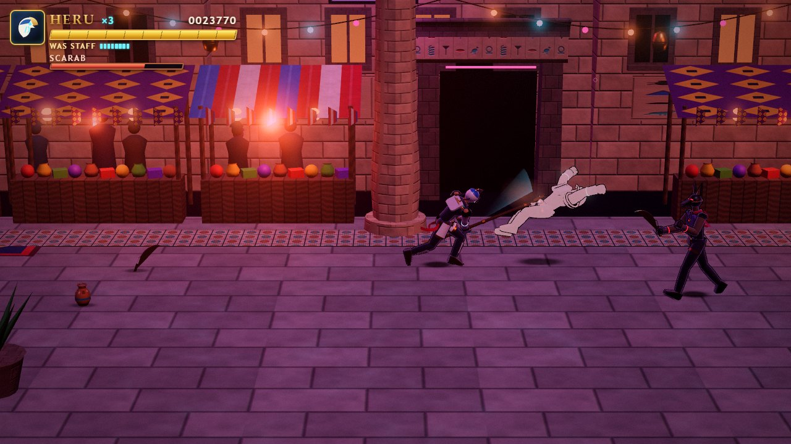
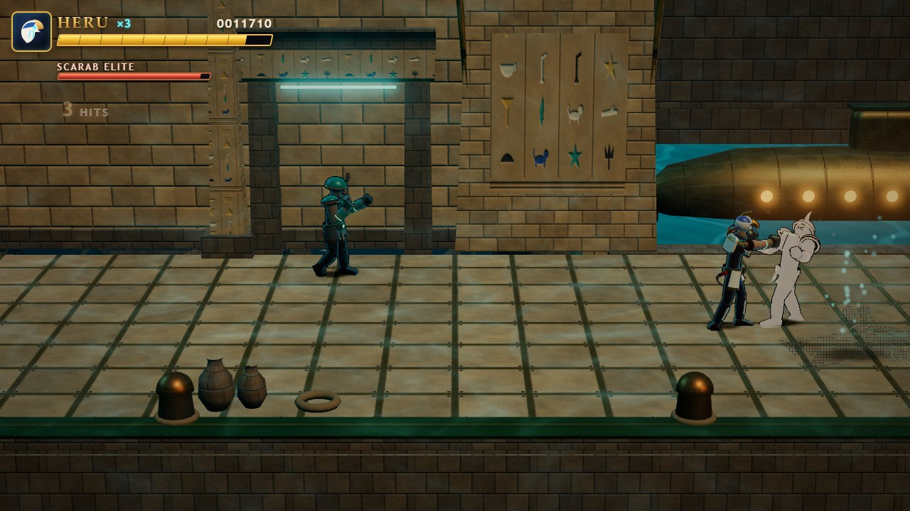
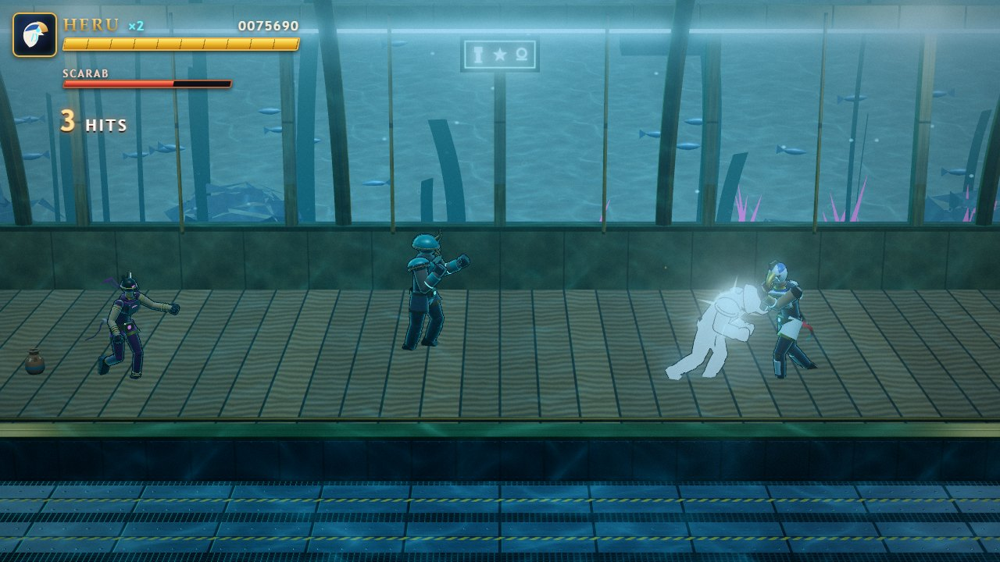
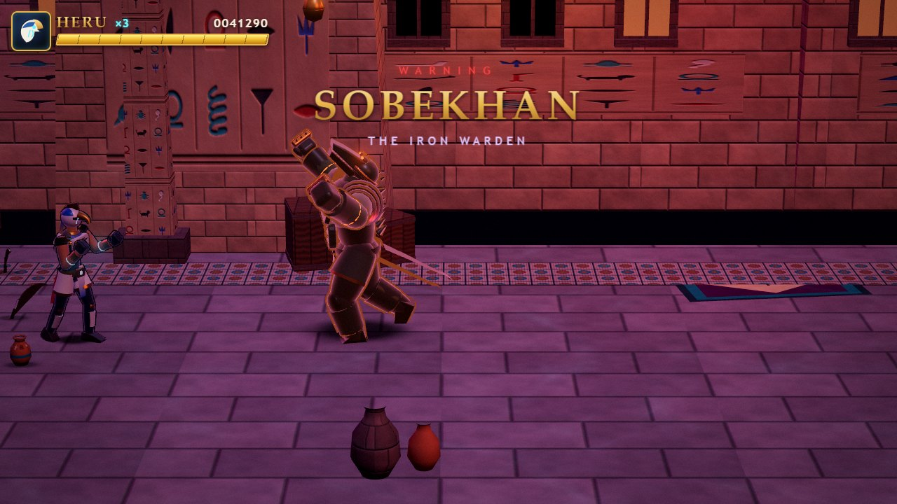
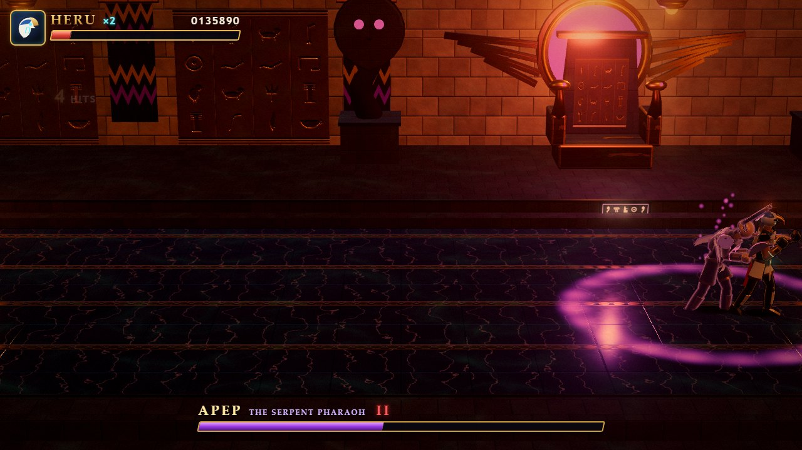
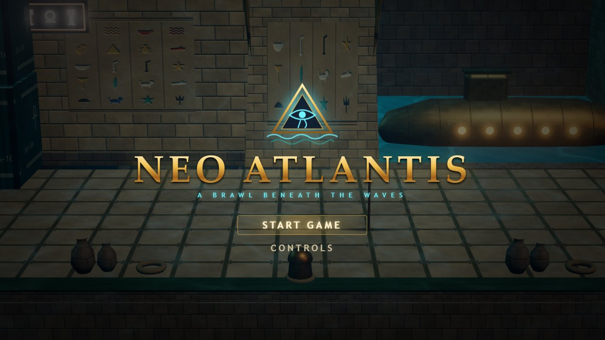
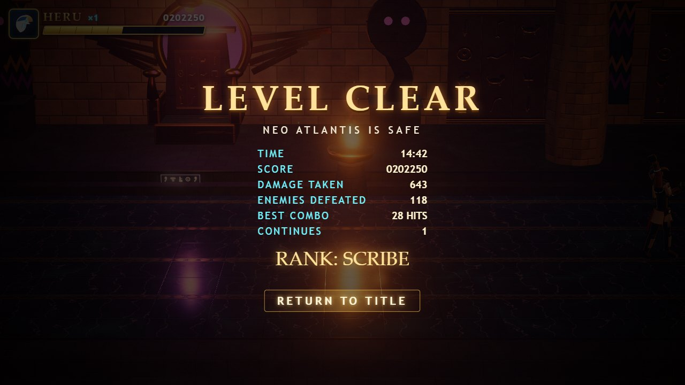
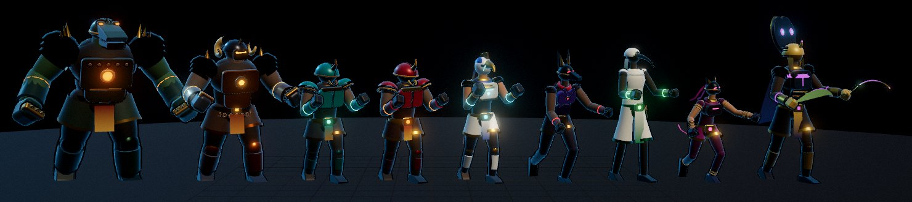

# Neo Atlantis

A 3D side-scrolling beat 'em up in the style of Streets of Rage 2, running in
the browser with Three.js. One complete level: title screen → Harbor Docks →
Bazaar Avenue (mid-boss) → Transit Tube (tram ride) → Temple Palace (final
boss) → level clear. Single player, gamepad first. Every model, animation,
texture and placeholder sound is generated in code.



| | |
| --- | --- |
|  |  |
|  |  |
|  |  |



Left to right: Sobekhan (mid-boss), Khnum (bruiser), Scarab (grunt), Scarab
Elite, Heru (the player), Jackal (blade runner), Ibis (thrower), Bastet
(acrobat), Apep (final boss).

## Run it

Requires Node 22.12 or newer (Vitest 5 needs it; developed on Node 22.17).

```bash
npm install
npm run dev          # http://localhost:5173  (hot reload)
```

Production build (a static folder you can host anywhere, relative paths):

```bash
npm run build        # type-checks, then writes dist/
npm run preview      # serves dist/ at http://localhost:4173
```

Tests and checks:

```bash
npm test             # Vitest: hit detection, combos, state machines, AI, determinism, full headless playthrough
npm run typecheck
npm run playtest     # Playwright end-to-end run (needs `npm run dev` running and Chrome installed)
npm run playtest -- --url=http://localhost:4173/   # the same run against `npm run preview`
```

`npm run playtest` opens Chrome, injects a virtual standard-mapping gamepad and
lets the autoplay bot play the whole level through it: press any button →
title → four stages → both bosses → level clear. It takes continues if
needed, saves screenshots to `shots/playtest/` and fails on any console or
page error. `node scripts/playtest.mjs --fast` runs the bot at 4× speed
through the input override. `--headed` shows the browser.

## Controls

| Action | Gamepad (standard mapping) | Keyboard |
| --- | --- | --- |
| Move (8-way; depth is slower) | Left stick / D-pad | Arrows / WASD |
| Attack, pick up weapon | X / Square | J or X |
| Jump | A / Cross | K, Z or Space |
| Run | RB / R1, or double-tap a direction | L / Shift, or double-tap |
| Pause | Start | Enter / Esc / P |
| Menus | Stick/D-pad, A to confirm, B to back | Arrows, Enter, Esc |
| Debug tools | – | F1 or ` |

- Tap attack for jab, jab, body blow, finisher. The chain only continues
  while your hits connect.
- Jump + attack: a neutral jump gives a downward kick, a moving jump gives a
  flying kick that knocks down.
- Attack while running for a lunging dash attack that knocks down.
- Stand over a weapon and press attack to pick it up: khopesh (fast 3-hit
  blade), was-staff (long reach, knocks down), clay jar (thrown, breaks on
  impact). Weapons wear out and drop when you're knocked down.
- 3 lives. A new life drops in where you fell, knocking down nearby enemies.
  Game over offers a continue from the start of the current stage.

Browsers only expose a gamepad after a button is pressed on it, which is why
the game opens on "PRESS ANY BUTTON". Unplugging the pad mid-game pauses.
Rumble is used where the browser supports it (Chrome's `dual-rumble`).

## Project layout

```
src/
  sim/        deterministic simulation (no three.js, no DOM)
    world.ts        createWorld / step(world, inputs[])  <- the only entry point
    actions.ts      fighter state machine and move runner
    combat.ts       hitbox/hurtbox detection, hit resolution
    player.ts       input → actions, 6-frame buffer, double-tap run
    ai.ts, boss.ts  enemy brains, attack tokens, boss patterns
    director.ts     encounters, camera locks, waves, transitions, boss intros
    spawn.ts, projectiles.ts, items.ts, view.ts (camera geometry)
  data/       all tuning (see below)
  render/     three.js renderer (reads the world, never writes it)
    characters/     rig, geometry helpers, 8 code-built models, weapons, CharacterView
    anim/           pose/clip system, animator (blending), springs, clip data
    env/            4 environment builders + modular pieces, water, fish, crowds…
    fx/             particles, shadows, rings, weapon trails, hit effects
    GameRenderer.ts, post.ts (bloom + grade), materials.ts, textures.ts
  input/      InputManager (gamepad + keyboard), bindings.ts
  audio/      AudioManager, event→sound mapping, synthesised placeholders, music
  ui/         HUD and menu screens (HTML/CSS overlay)
  debug/      debug panel, animation viewer, autoplay bot
  app/        App (screens + fixed-step loop), bootstrap
tests/        Vitest suites
scripts/      Playwright playtest and screenshot helpers
public/audio/ manifest.json + your sound files
```

The simulation advances in fixed 1/60 s steps. The renderer interpolates
positions and animation frames between the last two steps. Combat timing is
always expressed in frames.

## Tuning: the data files

Everything tunable is in `src/data/`. Each file is plain typed data, so the
type checker catches mistakes, and the dev server reloads on save.

| File | Contents |
| --- | --- |
| `tuning.ts` | Physics (gravity, knockback friction, bounce), player movement (jump speed, run, double-tap window), combat defaults (input buffer, hitstop and hitstun per hit type, depth tolerance, invulnerability windows, max attackers per player, rumble), camera geometry (pitch, FOV, distance, follow), boss-kill slow motion, level flow timing (walk-in, fades, stage title card, GO arrow, level-clear delay) |
| `moves.ts` | Every move: `startup` / `active` / `recovery` frames, hitboxes (belt-space box relative to the feet, authored facing right), damage, hit type (`light`/`heavy`/`knockdown`), hitstun, push/launch, hitstop override, combo chains, motion segments, armour windows, charges, projectiles, sounds |
| `fighters.ts` | Player/enemy/boss stats: health, hurtbox, walk/run speed, weight (knockback), score, lying/get-up time, the moves each one uses, and AI parameters (flank distance, attack range, token cooldowns, aggression, z-alignment tolerance, reaction delay) |
| `bosses.ts` | Boss patterns: intro length and name card, phase thresholds, summons and reinforcements, idle windows, attack choice distances, combo-breaker threshold |
| `weapons.ts` | Weapon durability, the move each weapon uses, pickup reach, ground lifetime. Projectile physics and hits (thrown jar, lobbed jar splash, shockwave ring) |
| `level.ts` | The four environments: length, lane depth, music slot, health refill, doors, weapon placements, and encounters (trigger x, camera lock x, waves with spawn side `left`/`right`/`door`/`drop`/`leap`, lane position, delays, carried weapons, tram, boss) |

Examples:

- Make the finisher launch farther: `moves.ts` → `finisher.hits[0].launchX`.
- Give grunts a slower wind-up: `grunt_jab.startup` (the animation stretches
  automatically, because clip keys sit on move phases).
- More enemies in the first fight: add entries to
  `ENVIRONMENTS[0].encounters[0].waves[n].spawns`.
- Tougher final boss: `fighters.ts` → `apep.hp`, or `bosses.ts` →
  `FINALBOSS.phase2`.
- Keyboard and gamepad bindings: `src/input/bindings.ts`.

Animation clips (`src/render/anim/clips/`) are also data. Each clip is a
list of keyed poses (joint rotations in degrees plus hips offset and squash)
with an easing per key. Move clips key against move phases (`['S', 0.5]` is
halfway through startup), so frame data always owns timing. The debug
animation viewer (F1 → *Open / close viewer*, or `index.html?viewer`)
plays any clip on any character with scrubbing.

## Swapping characters

Gameplay never touches meshes. The renderer asks a `CharacterVisual`
(`src/render/characters/CharacterView.ts`) to play a **logical clip name** at
a given time and to show facing, flash, fade, glow and a held weapon. The
code-built implementation poses a procedural rig. To use a rigged GLB instead:

1. Implement `CharacterVisual` with a class that loads the GLB (GLTFLoader),
   maps logical clip names (`idle`, `walk`, `jab_1`, `hit_heavy`, …; see
   `CLIP_SETS` in `render/anim/library.ts` for the full list per character) to
   `AnimationAction`s, and sets `action.time` from the request. For move
   clips, map the request's frame onto your clip using the move's
   `startup`/`active`/`recovery` (the request includes the `MoveDef`).
2. Return it from `GameRenderer.acquire()` for the model id you're replacing
   (model ids are in `data/fighters.ts`).

Nothing in `src/sim` changes. Hitboxes stay in data, so a new model can't
change how a move plays.

## Swapping audio

Drop files into `public/audio/` and list them in `public/audio/manifest.json`:

```json
{
  "sfx": {
    "hit_light": ["sfx/punch1.ogg", "sfx/punch2.ogg"],
    "boss_intro": ["sfx/gong.ogg"]
  },
  "music": {
    "env_docks": "music/docks.ogg",
    "boss_final": "music/apep.ogg"
  }
}
```

- SFX entries are arrays; one file is picked at random each time. Empty
  entries fall back to the synthesised placeholder.
- Music slots: `title`, `env_docks`, `env_bazaar`, `env_tube`, `env_temple`,
  `boss_mid`, `boss_final`, `level_clear`, `game_over`. Tracks loop
  seamlessly (decoded buffers).
- Sound event names: `hit_light`, `hit_heavy`, `hit_knockdown`, `hit_blade`,
  `hit_blunt`, `hit_armor`, `whiff`, `whiff_heavy`, `jump`, `land`, `throw`,
  `shatter`, `dash`, `leap`, `weapon_pickup`, `weapon_break`, `enemy_death`,
  `player_hurt`, `player_death`, `respawn`, `boss_intro`, `boss_roar`,
  `charge_windup`, `charge_go`, `wall_crash`, `shockwave`, `glint`,
  `power_up`, `door`, `go`, `stage_clear`, `level_clear`, `game_over`,
  `tick`, `ui_move`, `ui_confirm`, `ui_back`, `pause`.
- Which simulation events trigger which sounds is decided in
  `src/audio/events.ts`.

## Debug tools (F1 or `)

- Hitbox/hurtbox overlay (green: can be hit, grey: invulnerable, red:
  active hitbox, orange: projectiles; box depth is the z tolerance)
- Freeze and frame-step (`.` steps one frame), simulation speed ×0.25 to ×8
- God mode, AI off, autoplay bot
- Jump to any encounter of any stage, spawn any enemy type
- Animation viewer: any clip on any character or palette, scrub, speed,
  camera angle, held weapon
- Live FPS, draw calls, triangles, resolution scale, entity counts, current
  encounter and camera lock

Add `?debug` to the URL to open the panel on start.

## Performance

A character is about 5 draw calls (4 material groups + outline, rigid
skinning on a shared skeleton). An environment is a few dozen merged meshes
plus instanced fish, kelp and crowds. Particles, shadows and rings are one
instanced draw each. A typical fight frame is 55–90 draw calls and
110–185k triangles. Bloom runs at half resolution. If frames get slow, the
renderer lowers its resolution scale (down to 0.6) and raises it again when
there is headroom.

Frame times measured with `node scripts/perf.mjs` on the production build
at 1920×1080. The autoplay bot is fighting, resolution scaling is off
(pixel ratio 1), and vsync and the frame limiter are disabled so the real
cost of a frame shows. Each cell is average / 95th percentile.

| Scene | AMD Radeon 880M (integrated) | NVIDIA RTX 5070 Laptop |
| --- | --- | --- |
| Docks fight | 9.3 / 12.6 ms | 2.7 / 3.9 ms |
| Bazaar mid-boss | 8.5 / 13.8 ms | 2.4 / 3.6 ms |
| Tube tram ride | 9.9 / 14.0 ms | 3.5 / 4.8 ms |
| Temple mixed wave | 9.4 / 15.1 ms | 2.9 / 4.1 ms |
| Temple final boss | 9.4 / 14.9 ms | 2.7 / 4.0 ms |
| Stress: 15 fighters, 134 draws, 447k triangles | 10.9 / 14.6 ms | 4.7 / 6.2 ms |

60 fps needs 16.7 ms per frame, so even the integrated GPU keeps the 95th
percentile inside the budget at 1080p without lowering the resolution.
`--lowpower` measures on the integrated GPU, `--stress` runs the crowd
scene, `--size=1280x720` changes the window.

## How it was verified

- `npm test`: 38 tests. They cover hit detection, the combo chain and input
  buffer, jumps, runs and weapons, hit reactions and knockdowns, armour,
  lives, respawn and game over, attack tokens, depth alignment, the
  off-screen rule, flanking, determinism, camera locks and the GO arrow,
  continues, and a full headless playthrough of the level by the bot.
- `npm run playtest` against the production build: the bot played through
  the virtual gamepad from PRESS ANY BUTTON to the results screen in 14:42
  of game time, using one continue at the final boss. It fought all eight
  enemy and boss types, with no console or page errors. Screenshots of every
  environment, enemy type, the tram, and both boss intros, fights and final
  hits were reviewed. The images at the top of this file come from that run.
- `node scripts/menus.mjs` drives the menus with the keyboard: controls
  screen, pause, back behaviour, game over and continue.
